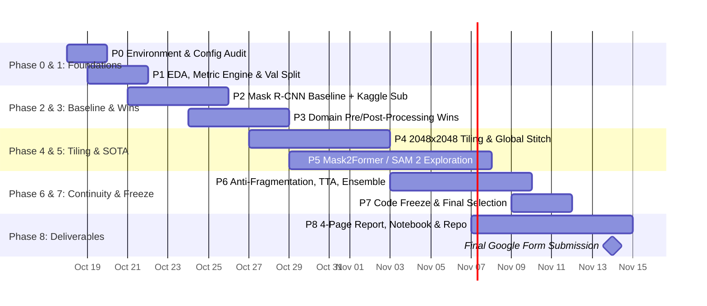

# 🌞 Solar Filament Instance Segmentation Challenge 2026
## 🗺️ Master Phase-by-Phase Project Execution Plan

> **Authoritative Project Roadmap**  
> **Source Context:** [Solar Filament Overview.txt](Solar%20Filament%20Overview.txt), [Solar_Filament_Segmentation_Plan.md](Solar_Filament_Segmentation_Plan.md), and [CLAUDE.md](CLAUDE.md).  
> **Current Date:** Sunday, Oct 18, 2026 | **Competition Deadline:** Sunday, Nov 15, 2026 (28 Days)  
> **Internal Code Freeze:** Wednesday, Nov 11, 2026 | **Final Package & Form Submission:** Saturday, Nov 14, 2026  
> **Target Metric:** Panoptic Quality ($\text{PQ}$) $> 0.35$ | **Scoring:** 70% Quantitative + 30% Qualitative  

---

## 📌 Table of Contents
1. [Core Competition Framework & Rubric](#1-core-competition-framework--rubric)
2. [Master Timeline & Visual Roadmap](#2-master-timeline--visual-roadmap)
3. [Phase 0 — Environment, Tooling & Architecture Audit (Oct 18–19)](#phase-0--environment-tooling--architecture-audit-oct-1819)
4. [Phase 1 — EDA, Metric Engine & Leak-Free Validation Protocol (Oct 19–21)](#phase-1--eda-metric-engine--leak-free-validation-protocol-oct-1921)
5. [Phase 2 — Baseline Model & Kaggle Verification (Oct 21–25)](#phase-2--baseline-model--kaggle-verification-oct-2125)
6. [Phase 3 — Solar Domain Preprocessing & Post-Processing Quick Wins (Oct 24–28)](#phase-3--solar-domain-preprocessing--post-processing-quick-wins-oct-2428)
7. [Phase 4 — Full-Resolution 2048×2048 Tiling & Global Stitching (Oct 27–Nov 2)](#phase-4--full-resolution-20482048-tiling--global-stitching-oct-27nov-2)
8. [Phase 5 — Query-Based Architecture: Mask2Former & SAM 2 (Oct 29–Nov 7)](#phase-5--query-based-architecture-mask2former--sam-2-oct-29nov-7)
9. [Phase 6 — Structural Continuity, TTA & Model Ensembling (Nov 3–9)](#phase-6--structural-continuity-tta--model-ensembling-nov-39)
10. [Phase 7 — Pipeline Freeze & Final Model Selection (Nov 9–11)](#phase-7--pipeline-freeze--final-model-selection-nov-911)
11. [Phase 8 — Deliverables, 4-Page Report & Open-Source Release (Nov 7–14)](#phase-8--deliverables-4-page-report--open-source-release-nov-714)
12. [Risk Management & Contingency Matrix](#12-risk-management--contingency-matrix)
13. [Team Role Assignments & Weekly Checkpoints](#13-team-role-assignments--weekly-checkpoints)
14. [Appendix — Lecture-Note Method Review (MCTA 4364)](#14-appendix--lecture-note-method-review-mcta-4364)

---

## 1. Core Competition Framework & Rubric

### 1.1 Objective & Data
- **Objective:** Instance segmentation of solar filaments from ground-based GONG $H\alpha$ observations ($2048 \times 2048$ pixels).
- **Data Scale:** 707 training images (8,199 filament instances), 180 test images (unannotated).
- **Instance Morphologies:** Areas range from $9\text{ px}^2$ to $37,739\text{ px}^2$ (mean $\sim 2,120\text{ px}^2$). Filaments are long, thin, curved, and possess delicate spine-orthogonal threads known as "barbs".

### 1.2 Evaluation Rubric (100% Total)
1. **Quantitative Evaluation (70%):**
   - **Primary Metric:** Panoptic Quality ($\text{PQ} = \text{SQ} \times \text{RQ}$) evaluated against ground-truth segmentations at $\text{IoU} > 0.5$.
   - **Secondary Distributions:** Mean Dice score, Dice score distribution, IoU distribution.
   - **Structural Penalty Counters:** Distribution of one-to-many ($1 \to N$, fragmentation) and many-to-one ($M \to 1$, over-merging) correspondences.
   - **Computational Efficiency:** End-to-end inference speed and memory footprint.
2. **Qualitative Evaluation (30%):**
   - **Pipeline Documentation:** Detailed methodology covering preprocessing, tiling, modeling, and post-processing.
   - **Visual Morphology:** Qualitative appearance and boundary delineation overlaid on H-Alpha imagery.
   - **Code Quality:** Modularity, clean docstrings, pinned reproducibility, and public access.

---

## 2. Master Timeline & Visual Roadmap



---

## Phase 0 — Environment, Tooling & Architecture Audit (Oct 18–19)
**Objective:** Establish a standardized, portable development environment across local GPU, Google Colab Pro, and Kaggle.

### Technical Workstreams
1. **Config Centralization & Portability:**
   - Update `src/config.py` so paths dynamically resolve via environment variable or current working directory instead of hardcoded absolute paths.
   - Separate paths, training hyperparameters, tiling parameters, and post-processing flags cleanly.
2. **Dependency Pinning:**
   - Maintain a frozen `requirements.txt` with specific compatible versions for PyTorch, Torchvision, Detectron2, Albumentations, Pycocotools, and Torchmetrics.
3. **Experiment Tracking Schema:**
   - Initialize `experiments/log.csv` to record every run:
     ```text
     exp_id, date, model, resolution, preproc, postproc, val_pq, val_sq, val_rq, val_dice, lb_score, sec_per_img, notes
     ```
4. **End-to-End Dry Run Verification:**
   - Ensure a 5-iteration dry-run produces a properly structured dummy `submission.csv` without throwing runtime errors.

### Quality Gate & Exit Criteria
- [x] Pipeline runs end-to-end on both local machine and cloud instances (Colab/Kaggle). *(Oct 19: full dry run on Colab T4, exp001; locally all non-Detectron2 steps + tests)*
- [x] `experiments/log.csv` initialized and ready for automated tracking.

---

## Phase 1 — EDA, Metric Engine & Leak-Free Validation Protocol (Oct 19–21)
**Objective:** Build a trustworthy offline validation setup that matches Kaggle's evaluation logic and prevents cross-image data leakage.

### Technical Workstreams
1. **Astrophysical EDA & Station Disambiguation:**
   - Image filename syntax: `YYYYMMDDhhmmss[Station]_[index].jpg`.
   - Identify observatories in the GONG network (Big Bear, Learmonth, Udaipur, Cerro Tololo, etc.).
   - *Leakage Risk:* Multiple telescopes image the identical solar disk features within the same hour/day.
   - *Action:* Implement **Date-Grouped Stratified Splitting** (`GroupKFold` grouped on date `YYYYMMDD`, stratified by filament count).
   - Freeze the 80/20 train/validation split into `splits/val_ids.json` (566 train, 141 val) with seed `42`.
2. **Panoptic Quality (PQ) Metric Implementation:**
   - Formal mathematical formulation:
     $$\text{PQ} = \text{SQ} \times \text{RQ}$$
     $$\text{SQ} = \frac{\sum_{(p, g) \in \text{TP}} \text{IoU}(p, g)}{|\text{TP}|}, \quad \text{RQ} = \frac{|\text{TP}|}{|\text{TP}| + 0.5|\text{FP}| + 0.5|\text{FN}|}$$
   - Matching condition: Ground-truth instance $g$ matches predicted instance $p$ iff $\text{IoU}(p, g) > 0.5$.
   - Extend `src/evaluate.py` to record:
     - Overall PQ, SQ, RQ, and Mean Dice score.
     - **Structural fragmentation penalty counters:** One-to-many ($1 \to N$) and many-to-one ($M \to 1$) correspondences.
     - **Size-stratified PQ:** Small ($< 200\text{ px}^2$), Medium ($200 - 2000\text{ px}^2$), Large ($> 2000\text{ px}^2$).
3. **Metric Alignment Verification:**
   - Validate `src/evaluate.py` directly against the organizer's Kaggle `self-evaluation-notebook`.
   - Verify GT vs GT outputs $\text{PQ} = 1.00000$.
   - Verify GT polygon $\to$ RLE encode $\to$ RLE decode $\to$ mask comparison confirms lossless round-trip.

### Quality Gate & Exit Criteria
- [x] `splits/val_ids.json` generated and permanently frozen. *(566 train / 141 val, 27-day time blocks)*
- [x] Local evaluator matches official Kaggle notebook output within $\pm 0.001$ PQ. *(Oct 20: both 0.3296 on 62 val files, annotator 1 as GT vs annotator 2 as pred; `src/make_metric_check_csvs.py`)*

---

## Phase 2 — Baseline Model & Kaggle Verification (Oct 21–25)
**Objective:** Establish a working anchor-based baseline model and verify the complete Kaggle submission lifecycle.

> **Decision (Oct 20):** Baseline model = **Detectron2 Mask R-CNN R50-FPN** (already proven by the Colab dry run). YOLOv8-seg deferred to a later comparison run.
>
> **Metric (Oct 20):** val PQ is measured with the official Kaggle rules (every annotator set scored, non-unique matching; `evaluate_official`, see `SelfEvaluationResult/FINDINGS.md`). Runner: `notebooks/colab_phase2_baseline.ipynb`.

### Technical Workstreams
1. **Detectron2 Mask R-CNN Customization:**
   - Backbone: ResNet-50 FPN (`mask_rcnn_R_50_FPN_3x`).
   - Anchor Scale Adaptation: Filament seeds and barbs are very small. Replace standard anchors with:
     $$\text{ANCHOR\_SIZES} = [[8], [16], [32], [64], [128]]$$
   - Anchor Aspect Ratios: Expand to `[0.2, 0.5, 1.0, 2.0, 5.0]` to fit elongated filament geometries.
2. **Training Setup:**
   - Input resolution: $1024 \times 1024$ (fast iteration, memory efficient).
   - Training schedule: Base LR 0.0025, batch size 2, 5,000–7,000 iterations (~15–20 epochs).
   - Augmentations: Random horizontal & vertical flips, slight brightness/contrast jitter.
3. **Submission Validator (`src/validate_submission.py`):**
   - Automatically check every generated submission before upload:
     1. Header check: `filament_id,segmentation_rle`.
     2. Filament ID format: `<image_id>_<idx>` where `<image_id>` matches test files.
     3. RLE format: Valid pycocotools counts string, unquoted, no array dimensions.
     4. Decoding validation: Decode a random sample of RLEs to ensure they unpack into $(2048, 2048)$ binary masks.
4. **First Kaggle Submission:**
   - Upload `submissions/submission_baseline_r50.csv`.
   - Record Baseline Validation PQ ($B_0$) and compare against Public Leaderboard PQ.
5. **Classical Baseline (Lecture W03–W04, W14 §3) — timeboxed 0.5 day, CPU only, optional:**
   - Disk mask → median-blur background subtraction (dark features) → adaptive threshold → morphological closing → connected components → `MIN_AREA` filter.
   - Purpose: a "classical vs learned" row for the report/ablation table, as the course workflow expects. Do **not** tune it beyond a few thresholds; expected PQ is low.

### Quality Gate & Exit Criteria
- [x] Baseline model trained and evaluated on the frozen validation set. *(Oct 20, exp003: official val PQ 0.3905 at score 0.8 = $B_0$)*
- [x] First valid submission scored on Kaggle Leaderboard with 0 errors. *(Oct 20: public LB 0.34; first try rejected for overlapping masks, fixed)*
- [ ] *(Optional)* Classical baseline PQ logged in `experiments/log.csv`.

---

## Phase 3 — Solar Domain Preprocessing & Post-Processing Quick Wins (Oct 24–28)
**Objective:** Leverage solar physics properties to eliminate false positives and boost Recognition Quality (RQ).

### Technical Workstreams
0. **Dice alignment (do first — Dice is graded, 70% quantitative block):**
   - The rubric uses mean Dice via `torchmetrics.segmentation.DiceScore`; our `mean_semantic_Dice` is unverified against it.
   - Reproduce their Dice on `output/metric_check/*.csv` and on baseline val predictions; align `evaluate.py` + add a test (same approach as the PQ check).
   - Report official PQ **and** Dice for every ablation row; a toggle that raises PQ but drops Dice must be flagged.
1. **Solar Preprocessing Pipeline (`src/preprocess.py`):**
   - **Solar Disk Isolation:** Use Hough Circle Transform / Otsu thresholding to compute the solar center $(x_0, y_0)$ and radius $R$. Zero out all non-solar background corners to eliminate instrument/corner artifacts.
   - **CLAHE Enhancement:** Apply Contrast-Limited Adaptive Histogram Equalization (`clipLimit=2.0`, `tileGridSize=(8, 8)`) to bring out thin barbs and faint spines.
   - **Limb Darkening Radial Normalization (conditional):** Correct for the natural darkening of the solar disk towards the edges. *Check first:* the EDA sample images already look radially flat (GONG products are typically limb-corrected). Plot the median radial intensity profile of ~20 train images; implement only if it drops > ~10% near the limb.
2. **Domain Post-Processing Pipeline (`src/postprocess.py`):**
   - **Small Instance Pruning (`MIN_AREA`):** Discard predicted instances with area $< 30-50\text{ px}^2$. Because false positives degrade RQ, pruning low-confidence noise yields substantial metric gains. *Data note:* the smallest selected GT instance is 60 px² (0 below 50), so sweeping `MIN_AREA` in {50, 60, 80, 100} is safe.
   - **Shape-Descriptor Filter (Lecture W04B §5) — ablation toggle, off by default:** Compute elongation (min-area-rect aspect ratio) and solidity per predicted mask. Drop only predictions that are **small AND compact AND very dark** (sunspot-like). Do not use a global elongation cut: small "Unidentifiable" GT filaments are often compact blobs and would be lost as FN. Keep it only if val PQ improves.
   - **Disk Perimeter Filtering:** Drop any predicted mask whose centroid lies outside the detected solar radius ($r > 0.98 \times R$).
   - **Morphological Spine Healing:** Apply morphological closing (`cv2.morphologyEx` with an elliptical kernel $3 \times 3$ or $5 \times 5$) along predicted masks to bridge narrow breaks.
   - **Pixel Conflict Resolution:** For overlapping masks, assign contested pixels to the instance with the higher confidence score.

### Quality Gate & Exit Criteria
- [ ] Produce **Ablation Table v1** documenting the metric change for each individual toggle.
- [ ] Achieve Validation $\text{PQ} \ge B_0 + 0.030$.

---

## Phase 4 — Full-Resolution 2048×2048 Tiling & Global Stitching (Oct 27–Nov 2)
**Objective:** Process images at native $2048 \times 2048$ resolution to preserve thin barbs and tiny filaments without GPU memory exhaustion.

### Technical Workstreams
1. **Overlapping Tiling Grid (`src/tiling.py`):**
   - Extract $1024 \times 1024$ patches with a 256-pixel overlap (stride 768).
   - This generates a deterministic $3 \times 3$ grid (9 tiles per full-disk image).
   - Skip outer tiles that fall completely outside the solar disk mask.
2. **Patch-Level Model Training:**
   - Train the segmentation network on cropped patches.
   - Clip ground-truth polygons at tile edges; prune edge slivers ($< 15\text{ px}^2$) to maintain training stability.
3. **Global Coordinate Stitching Engine:**
   - Map local tile predictions back into the global $2048 \times 2048$ frame:
     $$(x_{\text{global}}, y_{\text{global}}) = (x_{\text{tile}} + x_{\text{offset}}, y_{\text{tile}} + y_{\text{offset}})$$
   - *Border Reconciliation:* For filaments cut across tile borders:
     1. Match masks in the overlapping 256-pixel strip with high IoU.
     2. Merge contiguous masks that share directional continuity across tile boundaries.
     3. Apply Mask-IoU NMS ($\text{IoU} = 0.35$) to resolve redundant detections.

### Quality Gate & Exit Criteria
- [ ] End-to-end full-resolution inference operates within standard GPU VRAM constraints.
- [ ] Tiled full-resolution model outperforms $1024 \times 1024$ downsampled model on small filaments ($< 200\text{ px}^2$).

---

## Phase 5 — Query-Based Architecture: Mask2Former & SAM 2 (Oct 29–Nov 7)
**Objective:** Deploy transformer-based instance segmentation designed for thin, curvilinear, and complex structures.

### Technical Workstreams
1. **Mask2Former Implementation:**
   - Framework: Hugging Face `transformers` or Detectron2 Mask2Former.
   - Backbone: Swin-Transformer (Swin-T or Swin-S).
   - Benefits: Replaces box proposals with object queries that directly attend to high-resolution feature maps ($1/4$ scale), capturing thin barbs far better than anchor boxes.
   - Training Config: 100 queries, AdamW optimizer (LR $1 \times 10^{-4}$, backbone LR $1 \times 10^{-5}$, weight decay 0.05), trained on tiles.
2. **SAM 2 (Segment Anything 2) Exploration (Parallel Track, 2 Days Max):**
   - **Primary: box-prompt mask refinement (Lecture W11B §2 — "boxes are the most reliable prompt; detector + SAM").** Feed the best detector's boxes to SAM 2 and replace (or average with) its masks. No training needed; evaluate on val. Keep only if SQ rises without RQ dropping. Caveat: GT outlines are coarse (inter-annotator SQ ≈ 0.63), so sharper-than-label masks may not help.
   - *Secondary (only if time remains):* zero-shot automatic mask generator, filtered by absorption contrast (filaments are darker than background). Expect many FPs, since AMG segments everything.
3. **U-Net + Connected Components Fallback (Lecture W11A §3–4) — only if Mask2Former is No-Go or slips past Nov 2:**
   - `segmentation_models_pytorch` U-Net (ResNet-34 encoder), CE + Dice loss (handles thin-structure class imbalance), trained on 512–1024 tiles. Much cheaper and more stable to set up than Mask2Former.
   - Instances = connected components of the probability map after closing + `MIN_AREA`. Works because filaments are usually well separated on the disk; main risk is fragmentation of faint spines (mitigated by Phase 6 merging).
   - Different error profile from Mask R-CNN → useful ensemble member in Phase 6.
4. **Go / No-Go Decision Gate (Wednesday, Nov 4):**
   - Compare Mask2Former against the optimized Mask R-CNN on the frozen validation set.
   - If $\text{PQ}_{\text{M2F}} > \text{PQ}_{\text{MaskRCNN}}$: Promote Mask2Former to the primary architecture.
   - If competitive within $0.015$: Retain both models for ensembling.
   - If underperforming or unstable: Keep Mask R-CNN and redirect all resources to Phase 6.

### Quality Gate & Exit Criteria
- [ ] Formal Go/No-Go decision logged with comparative evaluation metrics.

---

## Phase 6 — Structural Continuity, TTA & Model Ensembling (Nov 3–9)
**Objective:** Eliminate fragmentation ($1 \to N$) and over-merging ($M \to 1$) penalties, apply TTA, and blend top models.

### Technical Workstreams
1. **Directional Anti-Fragmentation Merging:**
   - Algorithm:
     1. For each pair of predicted masks, compute the shortest Euclidean distance between their outer contours.
     2. Extract the principal orientation axis of each mask using Principal Component Analysis (PCA).
     3. If distance $< d_{\text{thresh}}$ (e.g. 15 px) **and** orientation angle difference $\Delta \theta < 20^\circ$, connect and merge the segments along their shared axis.
2. **Anti-Merging Constriction Separation (validation-gated):**
   - *Only implement if val shows a meaningful M→1 count.* Filaments naturally have narrow bottlenecks along the spine, so watershed (Lecture W04B §3) can split true single filaments. That creates fragmentation (1→N), which costs more than a merge. Restrict it to the largest predictions and test it as an ablation toggle.
   - For oversized predictions that appear to bridge two separate filaments:
     1. Compute distance transform map $\to$ identify multiple interior maxima.
     2. Apply watershed segmentation along narrow bottlenecks to restore physically distinct filaments.
3. **Test-Time Augmentation (TTA):**
   - Run inference across Original, Horizontal Flip, and Vertical Flip orientations.
   - Invert transformations and fuse probability masks via soft averaging.
4. **Ensemble Fusion:**
   - Combine predictions from Mask R-CNN and Mask2Former using Weighted Mask Fusion (WMF) with an IoU matching threshold of $0.40$.

### Quality Gate & Exit Criteria
- [ ] Validation metric shows a clear drop in one-to-many correspondence penalties.
- [ ] Total Validation PQ reaches target goal ($> 0.35$).

---

## Phase 7 — Pipeline Freeze & Final Model Selection (Nov 9–11)
**Objective:** Lock the final pipeline, profile computational efficiency, and select final Kaggle submissions.

### Technical Workstreams
1. **Model Selection Ground Rules:**
   - Final models are chosen **solely based on Local Validation PQ**, never on Public Leaderboard variance.
2. **Submission Strategy (3 Selected Submissions — uploads are unlimited, 3 are chosen as final):**
   - *Submission 1 (High Reliability):* Best single-model tiled pipeline with tuned domain post-processing.
   - *Submission 2 (Maximum Performance):* Multi-model ensemble with full TTA and anti-fragmentation merging.
   - *Submission 3 (Safety Net):* Best-Dice variant, or the strongest earlier pipeline if 1 and 2 are close on val (Dice is graded alongside PQ).
3. **Computational Efficiency Profiling:**
   - Measure and record:
     1. Per-image inference latency (seconds).
     2. Peak GPU memory footprint during $2048 \times 2048$ inference.
     3. Total throughput across the 180 test images (for inclusion in the technical report).
   - Latency: report median and p95 after warm-up, including pre- and post-processing (Lecture W14 §4 checklist).
4. **Robustness Breakdown (Lecture W14 §4) — near-zero cost:**
   - Report val PQ per GONG station (B, C, L, M, T, U; station = filename char 15) and per size bin. This shows generalisation across instruments and seeing conditions.
5. **Clean-Room Reproduction Check:**
   - Verify that running the pipeline from a fresh git clone reproduces the exact submission CSV file.
6. **Strict Code Freeze (Nov 11, 23:59):**
   - No code or hyperparameter modifications permitted after this milestone; only documentation and report writing.

### Quality Gate & Exit Criteria
- [ ] Final 3 submissions selected on the Kaggle platform.
- [ ] Reproduction verified on a clean machine.

---

## Phase 8 — Deliverables, 4-Page Report & Open-Source Release (Nov 7–14)
**Objective:** Maximize the 30% qualitative evaluation score and submit all competition deliverables ahead of the deadline.

### Technical Workstreams
1. **4-Page IEEE BigData Technical Report (Overleaf Template):**
   - *Section 1: Introduction & Domain Motivation* (Solar filaments, space weather impact, GONG data properties, PQ metric definition).
   - *Section 2: Pipeline Architecture* (Disk masking, CLAHE, $1024 \times 1024$ overlapping tiling, model backbone, global coordinate reconstruction).
   - *Section 3: Structural Continuity Algorithms* (Mathematical formulation of fragmentation penalties, PCA directional merging, small blob pruning).
   - *Section 4: Empirical Results & Discussion* (Comprehensive ablation table across all phases, PQ/SQ/RQ/Dice tables, Dice & IoU distribution plots, runtime efficiency analysis).
   - *Visual Figures:*
     - End-to-end pipeline diagram.
     - Qualitative morphology comparison: Original vs Baseline vs Final vs Ground Truth.
     - **Error gallery (Lecture W14 §3.3):** typical failures grouped as fragmentation, over-merge, faint/missed, limb, false positive (e.g. sunspot/plage), with a one-line explanation each.
     - Dice and IoU histogram distribution charts.
   - Use the W14 evaluation checklist as a final review of the report (baseline row, split by situation, test used once, latency, robustness, uncertainty).
2. **Reproducible Pipeline Notebook (`notebooks/full_pipeline.ipynb`):**
   - Self-contained, fully runnable notebook showing:
     1. Environment setup and dataset registration.
     2. Preprocessing demonstrations.
     3. Model inference and post-processing.
     4. Metric computation and RLE submission generation.
3. **Repository Finalization:**
   - Complete docstrings, type annotations, and clean module organization.
   - Publicly accessible GitHub repository with pinned `requirements.txt` (exact versions — use `requirements-lock.txt` from the final Colab run).
   - Repository must be public at competition close and stay public at least until winners are announced (**Nov 30**).
   - The committee must reproduce predictions with **no additional files**: weights downloaded automatically from a public link inside the notebook.
   - Host trained model weights on Google Drive / Hugging Face Hub with public download links.
   - Inference uses only the provided test H-alpha images; no extra ground-truth metadata in training (competition rule).
4. **Official Google Form Submission:**
   - Submit the Google Form by **Saturday, Nov 14** (24 hours prior to deadline) with:
     - 4-Page Technical Report PDF.
     - Public GitHub repository URL.
     - Full team identification details.

### Quality Gate & Exit Criteria
- [ ] Public GitHub repository accessible and fully documented.
- [ ] Google Form submitted and confirmation saved.

---

## 12. Risk Management & Contingency Matrix

| Identified Risk | Likelihood | Impact | Built-in Mitigation Strategy |
|:---|:---:|:---:|:---|
| **GPU Out-Of-Memory at 2048×2048** | High | High | Overlapping $1024 \times 1024$ tiling (Phase 4); raw full-res images are never fed directly to transformer backbones. |
| **Severe RQ Loss from Fragmentation** | High | High | Implement PCA directional healing and morphological closing (Phase 6); prune predictions $< 30\text{ px}^2$. |
| **Mask2Former Setup / Training Delays** | Medium | Medium | Strict Go/No-Go decision gate on Nov 4. Fall back immediately to optimized Mask R-CNN if setup exceeds 3 days. |
| **Cloud GPU Quota Exhaustion** | Medium | High | Maintain dual compute workflows: Google Colab Pro as primary, Kaggle GPU (30 hours/week) as backup. |
| **Public vs Private Leaderboard Drift** | High | High | Select final submissions strictly on frozen date-grouped validation PQ; do not overfit to public LB feedback. |
| **Last-Minute Report Writing Rush** | Medium | High | Decouple report drafting: Begin methodology, dataset, and architecture sections on Nov 7 in parallel with Phase 6. |

---

## 13. Team Role Assignments & Weekly Checkpoints

### 13.1 Role Allocations
- **Lead ML Engineer:** Phase 2 (Baseline), Phase 4 (Tiling Engine), Phase 5 (Mask2Former Architecture).
- **Computer Vision & Data Engineer:** Phase 1 (EDA), Phase 3 (Preprocessing/Post-processing), Phase 6 (Continuity Algorithms, TTA).
- **Evaluation & Metric Lead:** Phase 1 (PQ Metric Engine, Split), Phase 2 (Submission Validation), Phase 7 (Benchmarking).
- **Scientific Author & Project Lead:** Phase 0 (Tooling), Phase 8 (4-Page Report, Pipeline Notebook, Public Release).

### 13.2 Weekly Milestone Checkpoints
- **Week 1 (Sun, Oct 25):** Frozen date-grouped split, verified PQ metric engine, **first valid Kaggle submission**.
- **Week 2 (Sun, Nov 1):** Preprocessing/post-processing ablation table, tiled inference pipeline operational.
- **Week 3 (Sun, Nov 8):** Mask2Former evaluation resolved, continuity algorithms implemented, report outline drafted.
- **Week 4 (Sat, Nov 14):** Code frozen, final submissions locked, 4-page report complete, **Google Form submitted**.

---

## 14. Appendix — Lecture-Note Method Review (MCTA 4364)

Each method from the course notes was judged on expected PQ gain vs. implementation/compute cost. Verdicts are reasoned from the EDA, not yet measured; each "add" item is an ablation toggle that must earn its place on val PQ.

| Method (lecture) | Verdict | Where | Reason |
|:---|:---:|:---|:---|
| CLAHE, Hough disk mask, morph closing, `MIN_AREA` (W03–W04) | ✅ Already planned | Phase 3 | Cheap, standard, directly targets FP/fragmentation |
| Classical baseline (W04, W14) | ✅ Add (timeboxed) | Phase 2 | ~0.5 day CPU; gives report a baseline row; no PQ gain itself |
| Flat-field / limb-darkening (W03A) | ⚠️ Conditional | Phase 3 | Images look already limb-corrected; check radial profile first |
| Shape-descriptor filter (W04B) | ⚠️ Toggle | Phase 3 | Free to compute; global cut would delete compact small GT |
| Watershed split (W04B) | ⚠️ Gated | Phase 6 | Risk of fragmenting true filaments (1→N costs more than merges) |
| SAM box-prompt refinement (W11B) | ✅ Replace AMG | Phase 5 | Same 2-day slot; box prompts far better than automatic masks |
| U-Net + CE/Dice + CC (W11A) | ✅ Fallback | Phase 5 | Cheaper than Mask2Former; diverse ensemble member |
| Per-station robustness, latency p50/p95 (W14) | ✅ Add | Phase 7 | Near-zero cost, high report value |
| Error gallery, W14 checklist (W14) | ✅ Add | Phase 8 | Near-zero cost, high report value |
| Augmentation / transfer / LR schedules (W06B) | ✅ Already planned | Phase 2 | Flips + brightness/contrast; no colour jitter (monochrome) |
| Label noise & leakage (W09A) | ✅ Already done | Phase 1 | Supports annotator policy and the 27-day split in the report |
| Synthetic / copy-paste data (W13B) | ❌ Skip | — | Real data are sufficient; high effort, uncertain gain |
| CLIP / VLM auto-labelling (W13A) | ❌ Skip | — | Labels already exist; zero-shot is weak on solar imagery |
| Optics, calibration, stitching, motion, 3D (W01–W02, W05B, W10, W12) | ❌ N/A | — | Not relevant to single-image segmentation |
